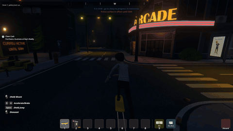

# Skate Schedule

Skate 3 skating inside **Schedule I**: pushing, steering, flick tricks, grinds, a following camera, avatar animation, and native skater bails/recovery.

[](docs/media/showcase.mp4)

[Full showcase with audio](docs/media/showcase.mp4) · 14 seconds, 720p at 60 fps. The short looping preview is silent. This development recording shows an earlier HUD.

This is an **experimental, single-player, source-only mod**. Schedule I runs under Proton on Linux, while a separate native Rust process supplies the reverse-engineered skating simulation. Your own PS3 Skate 3 gameplay data supplies animation and physics data. It does not run RPCS3 or execute the original PS3 game.

The integration follows [world-of-skatecraft](https://github.com/Kimmo3223/world-of-skatecraft). The simulation is an upstream work in progress, rather than a claim of exact retail behavior. No game files, exported assets, generated game DLLs, or prebuilt release bundle are provided.

## Compatibility and requirements

| Component | Tested configuration |
| --- | --- |
| Host | Linux x86_64; developed on Arch Linux |
| Schedule I | Steam Windows/IL2CPP build **0.4.7f12**, Unity **2022.3.62f2** |
| Skate 3 data | Extracted PS3 **BLUS30464**, USA/Asia edition |
| Loader | MelonLoader **0.7.3** under Proton Experimental **11.0-100** |
| Adapter | **0.1.22** |

You need installed copies of both games, Steam, Proton Experimental, **Rust/Cargo 1.95 or newer**, a C compiler/linker (`cc`), Git, and **Python 3.12 or newer** with `pip` and `venv`. Tested toolchains: Rust 1.98.1 and Python 3.14.7. Setup downloads a local .NET 10 SDK, MelonLoader, Cpp2IL, Unity reference libraries, a Windows .NET 6 runtime, and Python export dependencies into `vendor/`.

Allow disk space for downloaded tools, Rust build output and private exports. Setup needs internet access. Native Windows/macOS setup, Flatpak Steam layouts, the Mono/beta/demo game builds, multiplayer, and other PS3 editions have not been validated.

The installer expects a clean loader installation and refuses to overwrite existing MelonLoader/runtime/mod files. It does not merge an existing mod setup. Preserve your game saves and existing mod configuration before changing installations.

## Setup from source

Keep Schedule I closed during installation. Run these commands from the repository root, in the same shell. Replace the PS3 path; adjust the Schedule I path if needed.

### 1. Get the source and local tools

```bash
git clone https://github.com/SilentYeti/schedule-skate.git
cd schedule-skate

schedule_game="$HOME/.local/share/Steam/steamapps/common/Schedule I"
ps3_game="/path/to/Skate 3/PS3_GAME"

python3 scripts/setup_dev.py
```

Setup checks out pinned upstream revisions and applies the included collision/support fixes and held-board ownership export. It refuses conflicting vendor revisions/edits. Tools stay inside this checkout; this step does not install the mod into Schedule I.

### 2. Export data from your games

```bash
vendor/python/bin/python scripts/export_ps3.py --game "$ps3_game"
vendor/python/bin/python scripts/export_collision.py --game "$schedule_game"
```

The PS3 directory must contain `PARAM.SFO`, `USRDIR/EBOOT.BIN`, and `USRDIR/data/big/{miscload,miscboot,db}.big`. Point at an extracted `PS3_GAME` directory, not an ISO or RPCS3 installation.

Exports go to `data/ps3-assets/` and `data/schedule-collision/`. Exporters refuse existing destinations and paths overlapping the game. Preserve a working export or choose a separate output location instead of deleting it to rerun a command. Installation and the default launcher use the default locations above.

### 3. Build the native simulation

```bash
cargo build --locked
target/debug/skate-schedule --assets data/ps3-assets --smoke-test
```

The smoke test uses your exported data and a synthetic floor. It should complete without a failed pose or invalid packet. The native Cargo package still uses version 0.1.0; the adapter version identifies integration iterations.

### 4. Generate references for your Schedule I installation

```bash
vendor/dotnet/dotnet build tools/InteropTools/InteropTools.csproj

vendor/cpp2il/Cpp2IL \
  --game-path "$schedule_game" \
  --exe-name "Schedule I" \
  --output-as dummydll \
  --output-to data/game-dump \
  --use-processor attributeanalyzer,attributeinjector

vendor/dotnet/dotnet tools/InteropTools/bin/Debug/net10.0/InteropTools.dll \
  generate data/game-dump vendor/unity-2022.3.62 data/interop \
  "$schedule_game/GameAssembly.dll"
```

These are locally generated IL2CPP references, not downloadable game assemblies. Their game hash is checked during installation. The pinned Unity libraries target the tested build; a future game update may require code/tool changes as well as regenerated references.

### 5. Build and install the adapter

```bash
vendor/dotnet/dotnet build mod/SkateSchedule.csproj

python3 scripts/install_mod.py --game "$schedule_game" --dry-run
python3 scripts/install_mod.py --game "$schedule_game"
```

The installer copies MelonLoader, its portable runtime, the adapter, offline-generated references and your collision cache. It records ownership hashes in **`data/install-manifest.json`**. Keep this file and checkout: updates and safe removal depend on it. The dry run checks the initial file-copy plan; it does not execute or fully validate later interop/cache preparation.

If installation stops partway through, preserve the manifest and error message. It tracks completed copies for normal uninstall. Do not repeatedly force-copy files over a failed installation.

### 6. Launch

```bash
python3 scripts/launch.py --game "$schedule_game"
```

The launcher starts the native host, applies the required Proton DLL override and offline MelonLoader flags, and stops its host when the game exits. **Skate 3 mode is enabled on startup and connects automatically when you mount a skateboard** in a single-player game. F8 returns control to Schedule I; press it again to re-enable the integration. Normal waiting, connection and recovery states are silent. Only integration failures show a temporary error popup; routine details remain in the logs.

You can also use Schedule I's **Play** button in Steam. In **Properties → General → Launch Options**, enter the following, replacing the script path with your checkout's absolute path:

```text
python3 "/absolute/path/to/schedule-skate/scripts/launch.py" --steam-command %command%
```

In **Properties → Compatibility**, select the tested **Proton Experimental**. The wrapper starts the native bridge, forwards Steam's selected runtime/Proton command and environment, adds the loader flags/DLL override, then stops its bridge when the game exits. Keep the checkout at the configured path. Clear this launch option to stop using the wrapper; the installed adapter remains until you uninstall it.

The standalone command above uses the standard Steam root at `~/.local/share/Steam` and AppID 3164500's prefix there. `--game` selects a game folder and `--proton` selects a Proton executable; those standalone options do not relocate the Steam root/prefix. The Steam wrapper uses Steam's selected prefix and infers the game directory from its `Schedule I.exe` argument. Alternative Steam layouts have not been tested end to end.

## Controls

| Input | Action |
| --- | --- |
| F8 | Toggle the integration; enabled by default |
| F7, while connected | Force keyboard/mouse; toggle back to controller preference |
| WASD | Steer / walk |
| Space | Push / sprint on foot |
| E | Alternate push / jump on foot |
| C | Brake |
| F | Get on/off the native skateboard |
| Hold Alt + move mouse | Analog trick stick: charge and flick |
| Arrow keys | Trick-stick alternative |
| Right / left mouse | Left / right trigger grabs |
| Escape | Schedule I pause/menu |

Controllers use XInput; the first connected pad takes priority unless F7 selects keyboard/mouse. On-foot Skate 3 movement still runs inside the mounted Schedule I session, so native F board toggling differs from exiting with F8.

See **[CONTROLS.md](CONTROLS.md)** for stick clicks, bumpers, half-stick manuals, grab alternatives and mouse sensitivity calibration. Physical mouse feel and possible Schedule I key overlaps need wider in-game testing. SixAxis input is not transported.

## Status and limitations

Automatic mount connection, silent normal status, camera following, rider animation, improved arms, trick-dismount protection, mouse-look restoration and the bar hill improvement have been confirmed in-game on the development installation. Socket tests execute the actual C# input mapper; a generated mouse flick produces a native kickflip and returns to grounded riding. Headless tests cover failed-trick ragdoll recovery, walking, streamed collision and slope riding.

Known unfinished areas:

- Stutters and fully seamless mounts/remounts need further measurement in the rendered game.
- Some suburban hills remained bumpy; later fixes pass captured-road tests but still need confirmation there.
- A nonfinite on-foot launch after a grind/runout was traced to fourth-coordinate support motion and corrected. Its direct native regression passes; recurrence in real play still needs checking.
- The avatar maps 22 of 36 source bones. Fingers, separate foot IK and complete trick/skin coverage are unfinished.
- Carried-board placement now accounts for the visible rig's hand position using native possession ownership. Numeric alignment/ownership checks pass; the intermittent visible carry offset still needs in-game confirmation.
- Dynamic/unsupported colliders and differences from PhysX-cooked convex hulls remain limitations. Terrain and static boxes, spheres, capsules and cached meshes are supported.
- Grind rails are inferred from collision; authored rails, PS3 character graphics and multiplayer integration are not implemented.

Headless success does not establish rendered frame timing or exact retail simulation parity. Full input replays can diverge because collision replacements finish at different ticks; some captured replays did not reproduce the original failure.

## Updates and removal

For an adapter source update, quit Schedule I normally, pull the source, rebuild and use the ownership-aware updater:

```bash
git pull --ff-only
python3 scripts/setup_dev.py
cargo build --locked
vendor/dotnet/dotnet build mod/SkateSchedule.csproj
python3 scripts/install_mod.py --update-mod
python3 scripts/launch.py --game "$schedule_game"
```

If a new upstream patch conflicts with your existing vendor edits, stop and review it; setup refuses to overwrite conflicting changes. Native changes need a fresh launcher/host process. The updater/remover use the game path recorded in the manifest.

After a **game update**, retain old exports/references separately, regenerate collision and interop data against the new build, rebuild, and review compatibility before updating. Matching hashes prevent silently using a different build's cache; regenerating alone does not guarantee compatibility.

To remove tracked installation files with the game closed:

```bash
python3 scripts/install_mod.py --uninstall --dry-run
python3 scripts/install_mod.py --uninstall
```

Removal preserves saves, generated settings, logs and untracked files. It refuses externally modified tracked files. This removes files owned by this installer, not every file ever created by MelonLoader or the game.

## Troubleshooting and diagnostics

| Symptom | Check |
| --- | --- |
| Does not connect automatically | Use the launcher; check `MelonLoader/Latest.log` for `Skate Schedule` and loaded hooks. Mount a board in a single-player game and close menus. If previously disabled or stopped by an error, F8 re-enables it. |
| Keyboard/mouse ignored | Press F7 while connected; an idle pad otherwise takes priority. |
| Mouse tricks too sensitive/slow | Follow calibration in [CONTROLS.md](CONTROLS.md). |
| Port 31333 already in use | Inspect the existing bridge process. The launcher refuses an unknown host; do not start a second game/launcher. |
| Existing file/conflict during install | Preserve the existing loader/mod setup. Installation refuses to overwrite it. |
| Game hash/reference/cache mismatch | Verify the game version and regenerate local data for that exact build. |
| Unsupported/missing collision or numerical error | Preserve the error text/logs before restarting; do not disable validation to keep skating. |

The bridge listens on loopback `127.0.0.1:31333`. It has no authentication and should remain local; do not expose it through port forwarding.

Logs and captures:

- `data/logs/bridge.log`: native startup, collision and producer errors.
- `<game>/MelonLoader/Latest.log`: mod loading, hooks and integration failures.
- `<game>/SkateScheduleDiagnostics/`: bounded trace and newest 64 packed collision captures; a failure freezes eight recent worlds and the rejected request under `latest-failure/`.

Logs are replaced on later launches. Captures contain game-derived geometry and can include local paths. **Do not upload game assets, DLLs, collision captures or private exports to issues.** Start with the exact error, versions and steps; review text logs for personal paths before sharing.

See [docs/TESTING.md](docs/TESTING.md) for headless checks and [CONTRIBUTING.md](CONTRIBUTING.md) for code layout and useful bug reports.

## Credits and licensing

Project source is licensed under **[Apache-2.0](LICENSE)**; retain [NOTICE](NOTICE) and attribution in adapted files. Downloaded dependencies and commercial games have their own licences. Game data/references must be produced locally from your copies. This fan project is not affiliated with EA, Full Circle or TVGS.

- [world-of-skatecraft](https://github.com/Kimmo3223/world-of-skatecraft): integration example and rail detector, with original IW4L attribution retained.
- [2010-rust-rewrite-mashup](https://github.com/Kimmo3223/2010-rust-rewrite-mashup), pinned at `099b1948e9c08394b20c760ef123da38ef347278`: native Skate engine. The included patch adds collision and support-motion corrections.
- [skate-3-rust-engine](https://github.com/SK8-ENGINE/skate-3-rust-engine), pinned at `cb7968930f14dad38457e98720d1a274e469eec2`: owned-game export tools.
- [Skate3Recomp](https://github.com/mchughalex/skate3recomp#keyboard-keybinds): documented keyboard-layout reference, adapted with Alt mouse input.
- [MelonLoader](https://github.com/LavaGang/MelonLoader), [Cpp2IL](https://github.com/SamboyCoding/Cpp2IL), [Il2CppInterop](https://github.com/BepInEx/Il2CppInterop), [UnityPy](https://github.com/K0lb3/UnityPy), Rust/Bevy and .NET: supporting tools/libraries.
